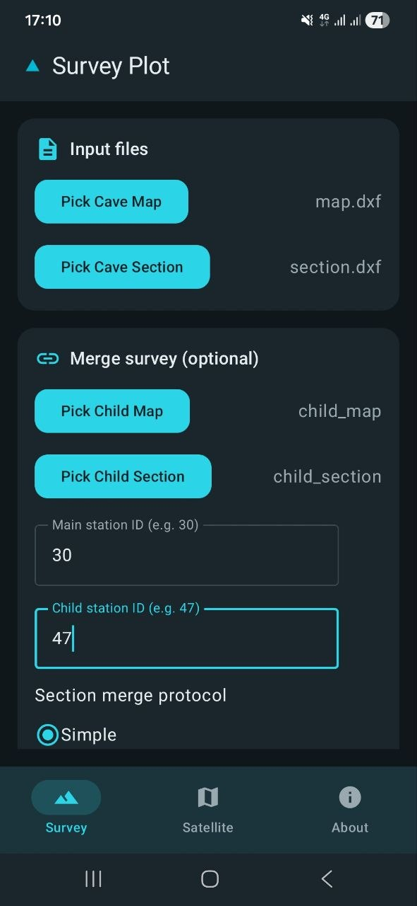
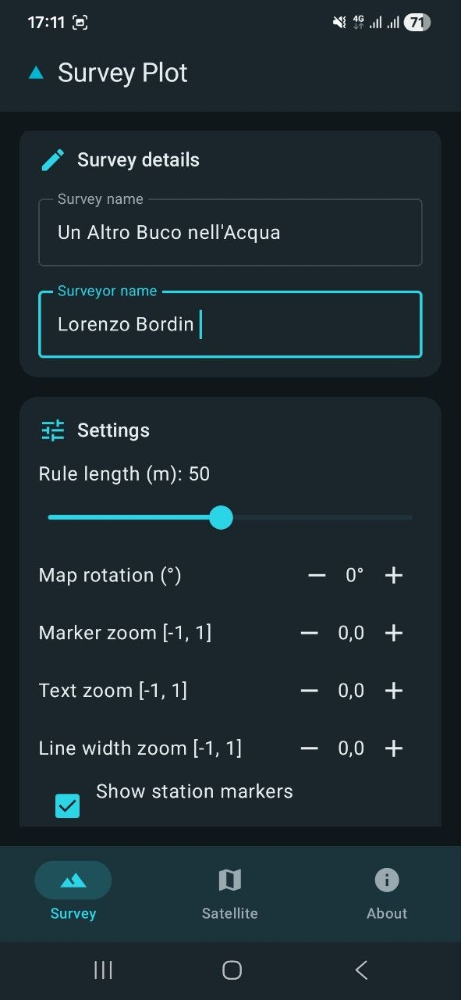
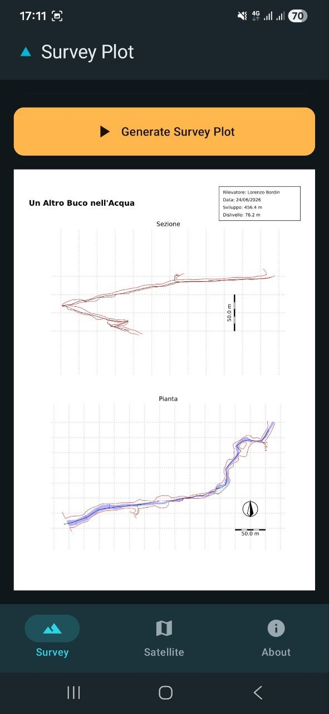
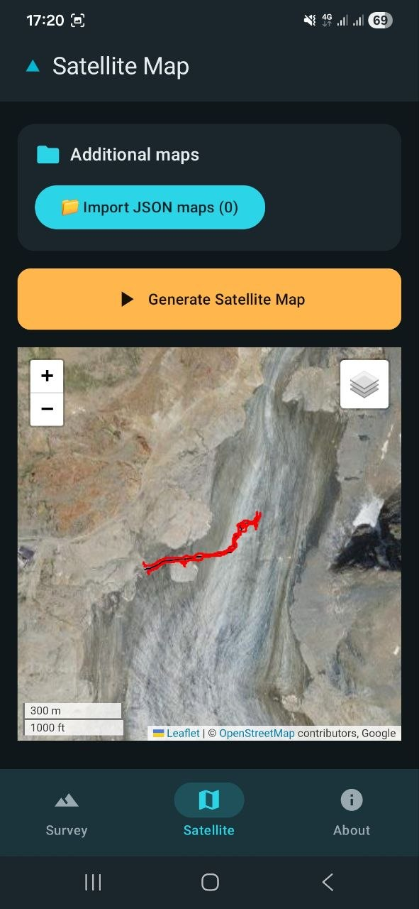
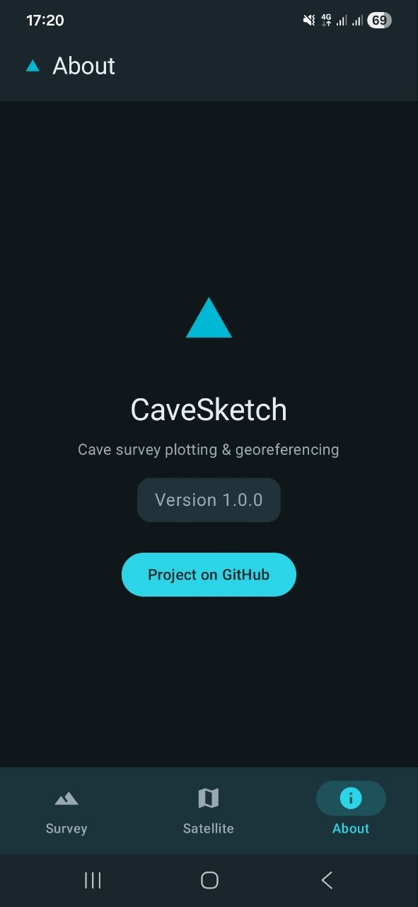

🌍 Available languages: [🇬🇧 English](README.md) | [🇮🇹 Italiano](README.it.md)

# CaveSketch for Android — User Guide

CaveSketch for Android is an offline-capable native Android app that uses the
same Python cave survey engine as the CaveSketch web app. All survey processing
happens **entirely on-device** — no server required.

---

## Installation

1. Download **`CaveSketch-v1.2.0.apk`** from
   [GitHub Releases](https://github.com/LorBordin/cave_sketch/releases).
2. Android will ask you to allow installs from unknown sources.
   Enable in **Settings → Apps → Special access → Install unknown apps** and
   grant permission to your browser or file manager.
3. Tap **Install**.

> [!TIP]
> **Upgrades**: Simply download a newer APK and install it over the existing
> version — your settings are preserved (the APK uses the same signing key).

---

## The Three Screens

### 📋 Survey Plot

Pick DXF (or previously exported CSV) files from your device and configure the survey output:

- **Survey name**, **surveyor**, and the optional title block fields: **drawer**, **municipality**, **latitude/longitude** (decimal degrees, both or neither) and **elevation** (m a.s.l.). Only filled-in fields are printed, and the title block is adaptively placed in a free corner to avoid overlapping the drawing.
- **Magnetic variation** (in Settings, +E/−W): rotates the map to true north and is printed in the title block when not 0.
- **Scale** and **rule length**
- **Rotation**
- **Marker / text / line-width zoom**
- **Station markers**, **polygonal centerline**, and **grid** toggles
- **TopoDroid DXF symbols**: **entrance**, **continuation**, **water-flow**, **blocks**, and **snow/ice** icons are rendered with accurate orientation.
- Optional **merge with a child survey**: match parent and child station IDs and choose the **map protocol** (**Simple** or **Displacement** with non-overlapping placement and a dashed connector line) and **section protocol** (**Simple**, **Mirror**, or **Displacement**).

Tap **Generate** to produce a PDF preview and exportable survey files:
- **PDF Survey Plot**
- **Map CSV** (parsed or merged plan data)
- **Section CSV** (parsed or merged section data)

Tap **Save / Share** on any output to either **Save to Device** (choose a local folder via the Android system file picker) or **Share** (send via the Android share sheet). The exported CSV files can be reopened as the primary survey to merge more than two sub-surveys iteratively.

---

### 🌍 Satellite Map

Add GPS reference points (station ID, latitude, longitude) and configure:

- **Survey name** and **rotation** (magnetic variation from Survey Plot is applied automatically)
- Optional **JSON map import** for multi-survey overlay

Tap **Generate** to produce:

- **HTML preview** (requires network for satellite tile servers)
- **JSON export** (cave map format)
- **KMZ export** (for Google Earth, including ground-scaled cave symbols and snow/ice icons)

Tap **Save / Share** on each output to **Save to Device** or **Share** independently.

---

### ℹ️ About

Displays the app version and provides a link to the
[GitHub repository](https://github.com/LorBordin/cave_sketch).

---

## Offline Behavior

| Feature | Offline | Notes |
|---|---|---|
| PDF generation | ✅ | Fully on-device |
| CSV export (Map & Section) | ✅ | Fully on-device |
| KMZ export | ✅ | Fully on-device |
| JSON export | ✅ | Fully on-device |
| Satellite HTML preview | 🌐 | Requires network for online tile servers |

> [!NOTE]
> When offline, the satellite HTML preview shows a
> **"No connection — satellite preview unavailable"** banner, but KMZ and JSON
> exports still generate normally.

---

## For Contributors

Interested in how the app is built? See the
[Architecture & Tech Stack](architecture.md) document for technical details on
the Android-specific implementation.

---

[Back to main README](../../README.md)
